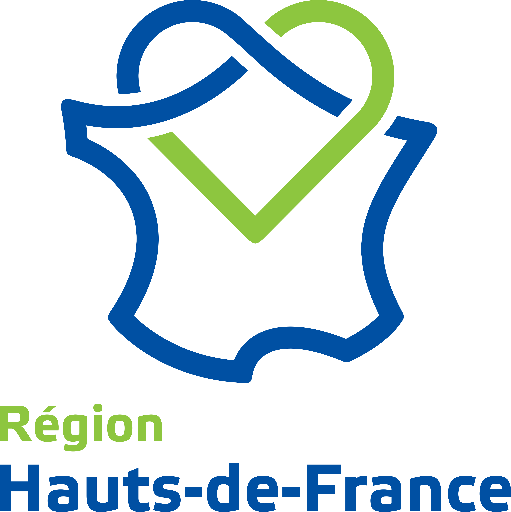
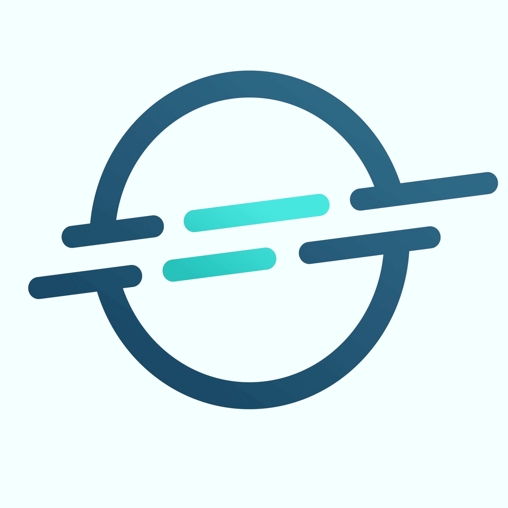

# 👋 Bonjour je m'appelle David !

### 👨‍💻 Je suis actuellement en poste au sein d'une mutuelle dans les Hauts-de-France 
---

### 👨‍🎓 En ce moment
Je poursuis une formation au sein de l'organisme Jedha  pour obtenir les diplômes de :
* 📊 Concepteur Développeur en Science de la Données
* 🤖 Architecte en Intelligence Artificielle 

---
### 📝 Blocs de certification
*  CDSD
    *   Bloc 1 - Construction et alimentation d'une infrastructure de gestion de données
        *   [Projet Kayak](CERTIF/CDSD/BLOC%201/01%20-%20Projet%20Kayak/)
    *   Bloc 2 - Analyse exploratoire, descriptive et inférentielle de données
        *   [Projet Tinder](CERTIF/CDSD/BLOC%202/02%20-%20Projet%20Tinder/) 
        *   [Projet Steam](CERTIF/CDSD/BLOC%202/03%20-%20Projet%20Steam/) 
    *   Bloc 3 - Analyse prédictive de données structurées par l'intelligence artificielle
        *   [Projet Walmart](CERTIF/CDSD/BLOC%203/04%20-%20Projet%20Walmart/) 
        *   [Projet Conversion rate challenge](CERTIF/CDSD/BLOC%203/05%20-%20Projet%20CRC/)
        *   [Projet North Face](CERTIF/CDSD/BLOC%203/06%20-%20Projet%20North%20Face/)
    *   Bloc 4 - Analyse prédictive de données non-structurées par l'intelligence artificielle
        *   [Projet AT&T](CERTIF/CDSD/BLOC%204/07%20-%20Projet%20AT&T/)
    *   Bloc 5 - Industrialisation d'un algorithme d'apprentissage automatique et automatisation des processus de décision
        *   [Projet Getaround](CERTIF/CDSD/BLOC%205/08%20-%20Projet%20Getaround/) 
    *   Bloc 6 - Direction de projets de gestion de données
        *   [Projet Auditeur Contrôle Médical](CERTIF/CDSD/BLOC%206/09%20-%20Projet%20Auditeur%20Contrôle%20Médical) 

* AIA
    *   Bloc 1 - Concevoir et piloter la gouvernance des données et des systèmes d’IA
        *   [Projet Spotify](CERTIF/AIA/BLOC%201/10%20-%20Projet%20Spotify) 
    *   Bloc 2 - Concevoir et déployer l’infrastructure de données et de calcul pour l’IA
        *   [Projet Stripe](CERTIF/AIA/BLOC%202/11%20-%20Projet%20Stripe) 
    *   Bloc 3 - Concevoir et mettre en œuvre des pipelines de données (pour l’IA)
        *   [Projet Fraud Detection](CERTIF/AIA/BLOC%203/12%20-%20Projet%20Fraud%20Detection) 
    *   Bloc 4 - Concevoir et piloter l’industrialisation et le déploiement de solutions d’IA
        *   [Projet Auditeur Contrôle Médical](CERTIF/AIA/BLOC%204/13%20-%20Projet%20Auditeur%20Contrôle%20Médical) 

## A MODIFIER !

### 🛠️ Mes outils préférés
| Catégorie | Technologies |
| :--- | :--- |
| **Langages** |   |
| **Data & analyse** |    |
| **Machine Learning** |  |
| **MLOps** |   |
| **API & backend** |  |
| **Bases de données** |   |
| **Visualisation** |   |
| **Collecte de données** |   |
| **Cloud & conteneurs** |   |
| **Outils** |    |

Deep learning :  ou . Pour un profil d’architecte en IA, c’est la ligne la plus attendue.
Orchestration de conteneurs : , à mettre dans « Cloud & conteneurs ».
CI/CD et tests :  et .
Démos rapides : .

### 📈 Mes Statistiques GitHub

---

*Dernière mise à jour : Mai 2026*
